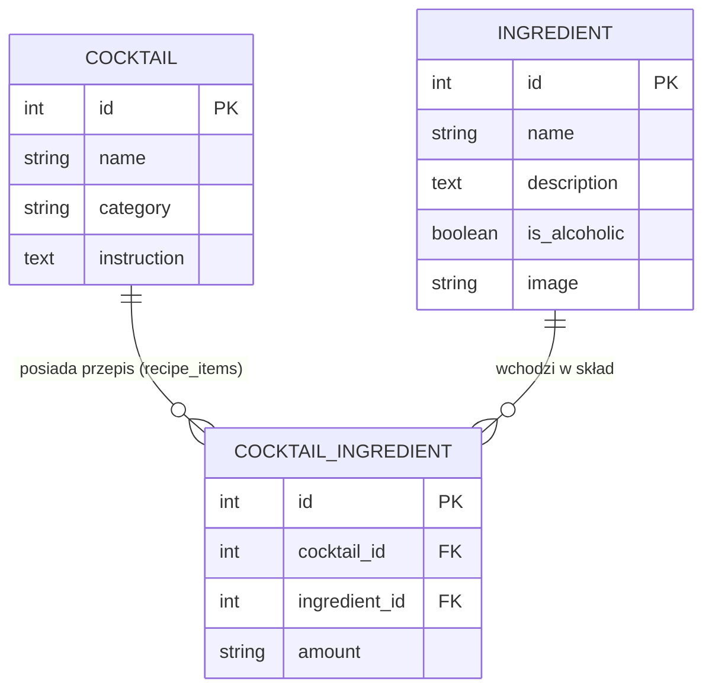

Cocktails & Ingredients REST API

REST API do zarządzania przepisami na koktajle oraz ich składnikami, stworzone w Pythonie (Django + Django REST Framework).

Główne funkcjonalności
- CRUD dla koktajli (`/api/cocktails/`) oraz składników (`/api/ingredients/`).
- Relacja Many-to-Many z tabelą pośrednią (`CocktailIngredient`)** przechowującą dokładne proporcje/ilości składników w przepisie.
- Paginacja wyników.
- Filtrowanie, wyszukiwanie i sortowanie (w tym filtrowanie koktajli bezalkoholowych oraz po nazwie składnika, np. `?is_alcoholic=false&ingredient_name=mięta`).
- Automatyczna dokumentacja OpenAPI / Swagger UI.

Schemat bazy danych



Jak uruchomić projekt lokalnie?

1. Sklonuj repozytorium i przejdź do folderu projektu.
2. Utwórz i aktywuj środowisko wirtualne:
   ```bash
   python -m venv .venv
   .venv\Scripts\activate
   ```
3. Zainstaluj wymagane biblioteki:
   ```bash
   pip install -r requirements.txt
   ```
4. Wykonaj migracje bazy danych:
   ```bash
   python manage.py migrate
   ```
5. Uruchom serwer deweloperski:
   ```bash
   python manage.py runserver
   ```

Dokumentacja API (Swagger)
Po uruchomieniu serwera interaktywna dokumentacja jest dostępna pod adresem:
- Swagger UI: `http://127.0.0.1:8000/api/docs/`
- Browsable API: `http://127.0.0.1:8000/api/`
